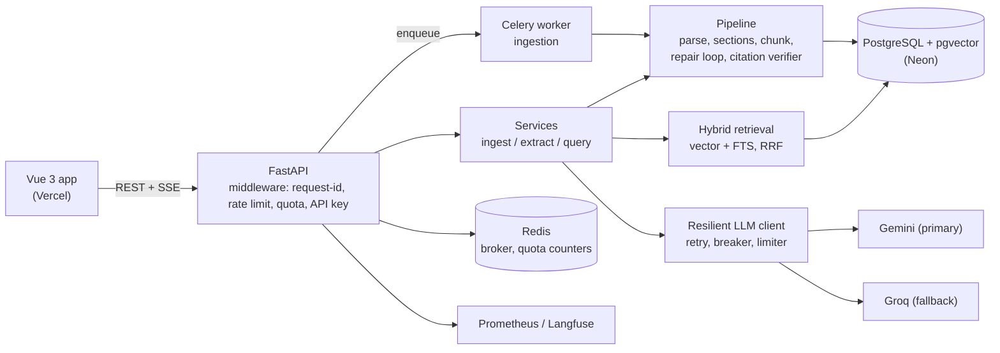

# ClauseGuard

**Contract review you can verify.** ClauseGuard ingests contract PDFs, extracts the clauses that matter into structured JSON, and answers questions over streaming SSE. Every quote it returns is checked against the source text by code, and anything that can't be matched is marked ungrounded instead of being presented as fact.


---

## Why it exists

Legal and procurement teams read the same ten clauses in every agreement, and a model that paraphrases confidently but wrongly is worse than no tool. ClauseGuard is built around one rule: **a model's output is a claim, and claims must be grounded.**

| Principle | How it is enforced |
|---|---|
| Quotes must exist | A deterministic `CitationVerifier` checks each quote against retrieved chunks: exact substring first, then a RapidFuzz similarity threshold (default 0.80). The result is stored as a grounding flag next to the clause. |
| Structured output must be valid | A repair loop validates model JSON against a Pydantic schema, re-prompts with the validation error, retries up to a bounded limit, and falls back to the second provider before returning a typed error. |
| Contract text is untrusted | Prompts instruct the model to ignore commands inside excerpts, and the adversarial eval checks that injected instructions cannot pass citation verification. |
| Providers fail | Retry with exponential backoff, a three-state circuit breaker, a token-bucket rate limiter and automatic Gemini-to-Groq failover. |
| Public demos burn money | Per-IP quotas on the three endpoints that spend tokens, an optional shared API key, explicit CORS, and a production start-up guard. |

## Features

- **Ingestion pipeline.** PDF parse, section detection, overlap-aware chunking (512 tokens, 64 overlap), embedding and storage in Postgres. Uploads are SHA-256 deduplicated and processed asynchronously by Celery.
- **Structured clause extraction.** Ten clause types (termination, liability cap, indemnity, auto-renewal, governing law, confidentiality, IP ownership, non-compete, force majeure, assignment), extracted in parallel with a concurrency cap. Each result carries a verbatim quote, page number, confidence and a grounding flag, plus latency, tokens and cost. Prompt templates are versioned (`v1`, `v2`) and selectable per request.
- **Grounded Q&A over SSE.** Token-by-token streaming answers with citations resolved to source chunks and pages. When the contract doesn't say, the model is required to answer "not found in the document".
- **Hybrid retrieval.** pgvector similarity and PostgreSQL full-text search fused with Reciprocal Rank Fusion (k = 60), with a clause-type filter and a token-budgeted context assembler.
- **Observability.** Prometheus metrics (requests, latency, LLM calls, tokens, cost in USD, repair attempts, citation verification rate, circuit-breaker state), optional Langfuse tracing, and a per-run cost ledger.
- **Review web app.** Vue 3 + TypeScript interface for the whole workflow (below).

## Architecture



The backend is strictly layered: **routes** validate input and shape HTTP/SSE responses only; **services** hold business logic and orchestration; **repositories** (a generic `BaseRepository` on SQLAlchemy 2.0) own queries; **models** and **schemas** keep persistence and API contracts separate.

### How a question is answered

```text
question -> embed -> vector search ┐
                                   ├─ RRF fusion -> context (token budget) -> LLM (streamed)
            full-text search ──────┘                                              │
                                                                                  v
                            citation verifier (quote must exist in a source chunk) -> SSE events
```

## Quickstart (local)

Requirements: Python 3.12, Docker, Bun.

```bash
cp .env.example .env              # set POSTGRES_PASSWORD (letters and digits only) and GEMINI_API_KEY / GROQ_API_KEY
make db-up                        # Postgres (pgvector) on :5434 and Redis on :6379
make migrate                      # Alembic migrations
make server                       # API on http://localhost:8000  (docs at /docs)
make worker                       # Celery ingestion worker (solo pool, macOS-safe), in another terminal
make frontend-install && make frontend    # web app on http://localhost:5173
```

Free API keys: Gemini at [aistudio.google.com/app/apikey](https://aistudio.google.com/app/apikey), Groq at [console.groq.com/keys](https://console.groq.com/keys). Langfuse (`LANGFUSE_*`) is optional.

To run everything in containers, including Postgres and Redis:

```bash
docker compose up --build         # api :8000, celery-worker, postgres :5434, redis :6379
```

`docker-compose.override.yml` adds hot reload and is applied automatically; use `docker compose -f docker-compose.yml up` to skip it. The API start script also runs an embedded Celery worker by default (`RUN_EMBEDDED_WORKER=true`), so set it to `false` if you run the dedicated `celery-worker` service.

### Commands

| Command | Action |
|---|---|
| `make db-up` / `make db-down` | Start / stop Postgres and Redis |
| `make migrate` / `make migrate-check` | Apply migrations / show current revision |
| `make server` | Uvicorn dev server on `:8000` |
| `make worker` | Celery ingestion worker |
| `make frontend-install` / `make frontend` / `make frontend-build` | Install, run, or type-check and build the web app |
| `make test` | Unit tests plus the evaluation harness |

### Configuration highlights

| Variable | Default | Purpose |
|---|---|---|
| `GEMINI_MODEL_ID` / `GROQ_MODEL_ID` | `gemini-flash-lite-latest` / `openai/gpt-oss-120b` | Primary and fallback models |
| `API_KEY` | empty (off) | Shared key required on `/api/v1` routes except `/health` |
| `CORS_ORIGINS` | `http://localhost:5173,http://localhost:5174` | Allowed browser origins |
| `TRUSTED_PROXY_HOPS` | `0` | Reverse-proxy hops to trust for client IP |
| `QUOTA_UPLOADS` / `QUOTA_EXTRACTIONS` / `QUOTA_QUESTIONS` | `5` / `10` / `40` | Per-IP limits per `QUOTA_WINDOW_S` (3600 s) |
| `MAX_REPAIR_ATTEMPTS` | `2` | Structured-output repair retries |
| `CITATION_SIMILARITY_THRESHOLD` | `0.80` | Minimum fuzzy match for a quote to count as grounded |
| `EXTRACTION_CONCURRENCY_CAP` | `4` | Parallel clause extractions |
| `RETRIEVAL_TOP_K` / `CONTEXT_TOKEN_BUDGET` | `5` / `6000` | Retrieval size and prompt budget |
| `ENABLE_METRICS` | `true` | Expose `/metrics` |

The full list is in `.env.example` and `app/core/config.py`.

## Testing and evaluation

```bash
make test        # pytest tests/ eval/ -v   (26 tests)
```

- **Unit tests** cover the chunker, citation verifier, repair loop, resilience primitives (retry, circuit breaker, rate limiter), routes, retrieval and services, and the security and quota behaviour.
- **Evaluation harness** (`eval/`) runs section-detection recall and citation groundedness against golden contract text, plus an adversarial prompt-injection case. The golden set is currently a single annotated sample (`eval/golden/cuad_samples.json`), shaped after CUAD; it is a regression guard, not a benchmark.
- `k6-script.sample.ts` is a load-test starting point, and `clauseGuardAPI.ts` is a generated TypeScript client for the API.

## Deployment

Designed for a free-tier stack: **Vercel** (static frontend) + **Render** (API container, `render.yaml` blueprint) + **Neon** (Postgres with pgvector) + Render Key Value (Redis). The API container applies migrations on every start. The step-by-step runbook, CORS wiring, quota verification behind a proxy, and a cost note are in [`DEPLOYMENT.md`](DEPLOYMENT.md).

## Project layout

```text
clauseguard/
├── app/
│   ├── api/v1/routes/      # HTTP and SSE only
│   ├── services/           # ingest, extraction and query orchestration
│   ├── repositories/       # SQLAlchemy 2.0 query layer (BaseRepository)
│   ├── models/ schemas/    # ORM models (pgvector) and Pydantic contracts
│   ├── pipeline/           # pdf parser, section detector, chunker, repair loop, citation verifier
│   ├── retrieval/          # embeddings, hybrid search (RRF), context assembler
│   ├── llm/                # Gemini and Groq providers, cost tracking
│   │   └── resilience/     # retry, circuit breaker, rate limiter, resilient client
│   ├── middleware/         # request id, rate limit, per-IP quota
│   ├── observability/      # Prometheus metrics, Langfuse
│   ├── prompts/            # versioned prompt templates
│   ├── workers/            # Celery app and ingestion task
│   └── core/               # config, security, constants, errors
├── frontend/               # Vue 3 + TypeScript app (Bun, Vite, TanStack Query)
├── eval/                   # golden data and evaluation harness
├── migrations/             # Alembic
├── tests/                  # unit tests
├── scripts/                # container entrypoints (migrate, worker, API)
├── Dockerfile  docker-compose.yml  render.yaml  DEPLOYMENT.md
└── Makefile
```

## Design notes and known limitations

I'd rather state these than have a reviewer find them.

- **Embeddings are a deterministic hash-based projection**, not a learned model. It keeps local development free and reproducible, and the tests deterministic, but retrieval quality is lexical-leaning and weaker than a real embedding model. The `EmbeddingClient` interface is the single place to swap in a hosted or local model; the vector column is 384-dimensional.
- **The evaluation set is small** (one annotated contract). Recall and groundedness numbers from it are smoke tests. Growing it with real CUAD contracts and tracking extraction F1 over time is the next step.
- **Section detection is rule-based** (heading regexes plus a keyword map). It works on conventionally formatted agreements and will miss unusual layouts.
- **Citation grounding is textual.** It proves a quote exists in the source, not that the model interpreted it correctly.
- **Quotas are per IP** and depend on `TRUSTED_PROXY_HOPS` matching the real proxy chain; `DEPLOYMENT.md` explains how to verify it.

## Tech stack

Python 3.12 · FastAPI · SQLAlchemy 2.0 (async) · Alembic · PostgreSQL + pgvector · Redis · Celery · Pydantic v2 · pypdf · RapidFuzz · tiktoken · Prometheus · Langfuse · Docker · Vue 3 · TypeScript · Vite · Bun · TanStack Query · pytest
